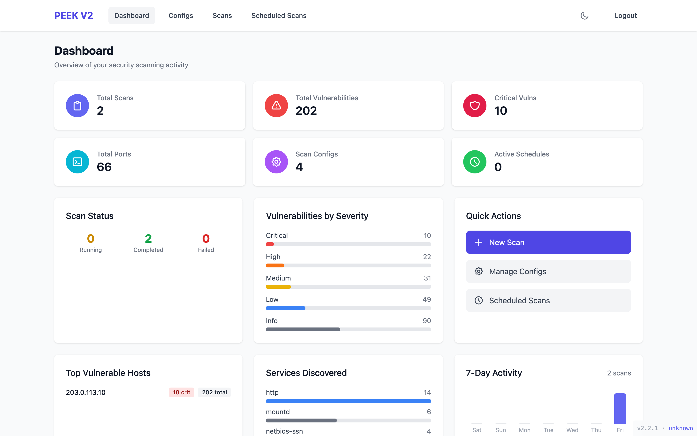

```
 ____  _____ _____ _  __  __     _______
|  _ \| ____| ____| |/ /  \ \   / /___ /
| |_) |  _| |  _| | ' /    \ \ / /  |_ \
|  __/| |___| |___| . \     \ V /  ___) |
|_|   |_____|_____|_|\_\     \_/  |____/

Port Enumeration & Evaluation Kit
```

<div align="center">

[](https://www.docker.com/)
[](https://fastapi.tiangolo.com/)
[](https://reactjs.org/)
[](https://www.typescriptlang.org/)
[](https://opensource.org/licenses/MIT)
[](https://github.com)

**Modern network security scanner with historical comparison capabilities**

[Features](#-features) • [Quick Start](#-quick-start) • [Architecture](#-architecture) • [Documentation](#-documentation) • [Contributing](#-contributing)

</div>

---

## 🎯 Overview

**PEEK V2** is a comprehensive network security scanning platform that combines multiple industry-standard security tools into a unified, user-friendly interface. Built for security professionals, network engineers, and DevOps teams, PEEK automates vulnerability discovery, service enumeration, and compliance auditing while tracking changes over time.

### Why PEEK?

- **Unified Platform**: Orchestrates 8+ security tools through a single interface
- **Historical Tracking**: Compare scans over time to identify new vulnerabilities and configuration changes
- **Service-Aware Scanning**: Automatically selects appropriate vulnerability checks based on detected services
- **Flexible Scheduling**: Configure recurring scans with cron-based scheduling
- **Rich Reporting**: Export findings in PDF, HTML, and CSV formats
- **Modern UI**: Dark mode support, real-time progress tracking, and intuitive dashboards

---

## ✨ Features

### 🔍 Comprehensive Security Scanning

| Tool | Purpose | Capabilities |
|------|---------|--------------|
| **Nmap** | Port & Service Discovery | Top-ports discovery, service versioning, NSE scripting |
| **Nuclei** | Vulnerability Detection | 5000+ templates with service-aware filtering |
| **ssh-audit** | SSH Hardening Analysis | Algorithm assessment, CVE detection, compliance scoring |
| **sslscan** | TLS/SSL Assessment | Protocol support, cipher strength, certificate validation |
| **Nikto** | Web Server Scanning | Misconfiguration detection, known vulnerability checks |
| **OWASP ZAP** | Web App Testing | Baseline security scans, automated spidering |
| **httpx** | HTTP Probing | Technology detection, HTTP pipeline analysis |
| **masscan** | Fast Port Scanning | High-speed SYN scanning (alternative mode) |

### 📊 Scan Pipeline (8 Phases)

```
1. Port Discovery (0-10%)      → Identifies open ports
2. Service Detection (10-80%)   → Determines service versions
3. SSH Audit (80-85%)           → Analyzes SSH security
4. Vulnerability Scan (85-90%)  → Nuclei templates by service
5. NSE Scripts (90-95%)         → Nmap scripting engine
6. SSL/TLS Analysis (95-97%)    → Certificate and cipher checks
7. Web Server Scan (97-98%)     → Nikto security tests
8. Web App Testing (98-100%)    → OWASP ZAP baseline scan
```

### 🎨 Modern Features

- **Smart Dashboard**: Real-time statistics, recent scans, vulnerability summaries
- **Dark Mode**: User-controlled theme with persistent preferences
- **Historical Comparison**: Diff engine showing new/closed ports and vulnerability changes
- **Scan Configurations**: Reusable profiles with tool toggles, timeouts, and severity filters
- **Scheduled Scans**: Cron-based recurring scans with automatic execution
- **Report Generation**: Professional reports with charts, tables, and executive summaries
- **RESTful API**: Full OpenAPI/Swagger documentation at `/docs`

---

## 🚀 Quick Start

### Prerequisites

- Docker 20.10+ and Docker Compose 2.0+
- 4GB RAM minimum (8GB recommended)
- 10GB disk space for tool images and scan data

### Installation

1. **Clone the repository**
   ```bash
   git clone https://github.com/yourusername/peek.git
   cd peek
   ```

2. **Configure environment**
   ```bash
   cp backend/.env.example backend/.env
   # Edit backend/.env and set SECRET_KEY
   openssl rand -hex 32  # Use this output as SECRET_KEY
   ```

3. **Start all services**
   ```bash
   docker compose up -d
   ```

4. **Access the application**
   - **Frontend UI**: http://localhost:3000
   - **API Documentation**: http://localhost:8000/docs
   - **Backend Health**: http://localhost:8000/api/health

5. **Login with default credentials**
   - Username: `admin`
   - Password: `admin`
   - **⚠️ Change immediately in production!**

### First Scan

1. Navigate to **New Scan** in the UI
2. Enter target (IP, hostname, or CIDR range)
3. Select scan configuration or use defaults
4. Click **Start Scan** and monitor progress
5. View results in **Ports** and **Vulnerabilities** tabs

---

## 🏗 Architecture

```
┌─────────────┐      ┌─────────────┐      ┌─────────────┐
│   React     │────▶ │   FastAPI   │────▶ │   Celery    │
│  Frontend   │      │   Backend   │      │   Worker    │
│  (Port 3000)│      │  (Port 8000)│      │             │
└─────────────┘      └─────────────┘      └─────────────┘
       │                    │                     │
       │                    │                     ▼
       │                    │              ┌─────────────┐
       │                    │              │   Security  │
       │                    │              │    Tools    │
       │                    │              │  (8 tools)  │
       │                    │              └─────────────┘
       │                    ▼                     │
       │             ┌─────────────┐             │
       └────────────▶│   SQLite    │◀────────────┘
                     │  Database   │
                     │  (WAL mode) │
                     └─────────────┘
                            ▲
                            │
                     ┌─────────────┐
                     │ Celery Beat │
                     │  Scheduler  │
                     └─────────────┘
```

### Technology Stack

#### Backend
- **Framework**: FastAPI 0.109 with OpenAPI/Swagger
- **ORM**: SQLAlchemy 2.0 (async)
- **Database**: SQLite with WAL mode (async via aiosqlite)
- **Task Queue**: Celery 5.3 + Redis 7
- **Validation**: Pydantic 2.5
- **Auth**: JWT tokens (python-jose, bcrypt) - 7-day expiration

#### Frontend
- **Framework**: React 18 with TypeScript 5.3
- **Build Tool**: Vite 5
- **Routing**: TanStack Router
- **Data Fetching**: TanStack Query (React Query)
- **State Management**: Zustand
- **Styling**: Tailwind CSS 3.4
- **UI Components**: Custom component library with dark mode

#### Infrastructure
- **Containerization**: Docker with multi-stage builds
- **Orchestration**: Docker Compose
- **Message Broker**: Redis 7
- **Reverse Proxy**: Nginx (production)

### Data Model

```
ScanConfig (Reusable scan profile)
  ├── targets: [IP, hostname, CIDR]
  ├── tool_settings: JSON configuration
  └── schedule: Cron expression
       │
       ├─▶ Scan (Execution instance)
       │    ├── run_number: Auto-increment per config
       │    ├── status: pending/running/completed/failed
       │    └── progress: 0-100%
       │         │
       │         ├─▶ ScanTarget (Per-target results)
       │         │    └─▶ Port (Discovered services)
       │         │         ├── service, version, product
       │         │         └─▶ Vulnerability
       │         │              ├── severity, CVE, description
       │         │              └── tool: nuclei/nikto/zap/nse
       │         │
       │         ├─▶ SSHAudit (SSH analysis)
       │         ├─▶ SslScanResult (TLS analysis)
       │         ├─▶ NseFinding (NSE script output)
       │         └─▶ ToolExecution (Raw output)
       │
       └─▶ ScanComparison (Baseline diff)
            ├── new_ports, closed_ports
            └── new_vulns, resolved_vulns
```

---

## 📦 Docker Services

| Service | Port | Purpose | Auto-Start |
|---------|------|---------|------------|
| `frontend` | 3000 | React UI (Nginx in prod) | Yes |
| `backend` | 8000 | FastAPI + Swagger docs | Yes |
| `celery` | - | Scan execution worker | Yes |
| `celery-beat` | - | Scheduled scan scheduler | Yes |
| `redis` | 6379 | Celery message broker | Yes |
| `zap` | 8090 | OWASP ZAP daemon (optional) | No |

### Docker Commands

```bash
# Start all services
docker compose up -d

# View logs
docker compose logs -f celery        # Worker logs
docker compose logs -f backend       # API logs
docker compose logs -f frontend      # Nginx logs

# Rebuild after code changes
docker compose up -d --build backend celery celery-beat

# Stop all services
docker compose down

# Stop and remove volumes (DELETES DATABASE)
docker compose down -v
```

---

## 🔧 Development Setup

### Backend Development

```bash
cd backend

# Create virtual environment
python3 -m venv venv
source venv/bin/activate  # On Windows: venv\Scripts\activate

# Install dependencies
pip install -r requirements.txt

# Set environment variables
export DATABASE_URL="sqlite+aiosqlite:///./peek.db"
export SECRET_KEY="your-secret-key-here"

# Run development server
uvicorn app.main:app --reload --port 8000

# In separate terminal: Start Celery worker
celery -A app.celery_app worker --loglevel=info

# In another terminal: Start Celery beat scheduler
celery -A app.celery_app beat --loglevel=info
```

### Frontend Development

```bash
cd frontend

# Install dependencies
npm install

# Start development server
npm run dev

# Build for production
npm run build

# Preview production build
npm run preview

# Type checking
npm run typecheck

# Linting
npm run lint
npm run lint:fix
```

### Running Tests

```bash
# Backend tests
cd backend
pytest tests/ -v

# Frontend tests
cd frontend
npm test
npm run test:coverage
```

---

## 📚 Documentation

| Document | Description |
|----------|-------------|
| [Usage Guide](docs/usage-guide.md) | Step-by-step user manual |
| [Architecture](docs/architecture.md) | System design and components |
| [API Documentation](http://localhost:8000/docs) | Interactive Swagger/OpenAPI docs |
| [Scan Lifecycle](docs/scan-lifecycle.md) | Detailed scan phase breakdown |
| [Data Model](docs/data-model.md) | Database schema and relationships |
| [Extending Scanners](docs/extending-scanners.md) | Adding new security tools |
| [Troubleshooting](docs/troubleshooting.md) | Common issues and solutions |
| [Performance](docs/performance.md) | Optimization and tuning guide |
| [Contributing](docs/contributing.md) | Development guidelines |

---

## 🔐 Security Considerations

### Default Credentials
The default `admin/admin` credentials are **ONLY** for development. For production:

1. Change admin password immediately after first login
2. Create individual user accounts for each team member
3. Disable the default admin account after creating alternatives

### JWT Token Security
- Tokens expire after 7 days
- Store tokens securely (localStorage with HttpOnly consideration for production)
- Rotate the `SECRET_KEY` regularly in production environments

### Network Scanning Ethics
- **Only scan networks you own or have explicit permission to test**
- Unauthorized scanning may violate computer fraud laws
- Configure appropriate timeouts to avoid DoS conditions
- Review and comply with your organization's security policies

### Tool Safety
All integrated tools are:
- Open source with active communities
- Industry-standard security testing tools
- Regularly updated in Docker images
- Isolated in containers for safety

---

## 🎨 Screenshots

### Dashboard
> Modern dashboard with scan statistics, recent activity, and vulnerability summaries



### Scan Results
> Detailed port enumeration with service detection and vulnerability mapping


### Historical Comparison
> Side-by-side diff showing infrastructure changes over time


### Dark Mode
> Full dark mode support with user-controlled toggle


---

## 🛠 Configuration

### Scan Configuration Options

Configure scanning behavior via the UI or API:

```json
{
  "name": "Production Infrastructure",
  "targets": ["192.168.1.0/24", "webserver.example.com"],
  "nmap_enabled": true,
  "nmap_top_ports": 1000,
  "nmap_timing": "T3",
  "nuclei_enabled": true,
  "nuclei_severity": ["critical", "high", "medium", "low"],
  "ssh_audit_enabled": true,
  "sslscan_enabled": true,
  "nikto_enabled": false,
  "zap_enabled": false,
  "scan_timeout": 3600,
  "schedule": "0 2 * * 0"  // Weekly at 2 AM Sunday
}
```

### Environment Variables

Create `backend/.env` from template:

```bash
# Security
SECRET_KEY=your-secret-key-generated-with-openssl
ACCESS_TOKEN_EXPIRE_DAYS=7

# Database
DATABASE_URL=sqlite+aiosqlite:///./data/peek.db

# Celery
CELERY_BROKER_URL=redis://redis:6379/0
CELERY_RESULT_BACKEND=redis://redis:6379/0

# External Tools
ZAP_API_KEY=your-zap-api-key
ZAP_PROXY_URL=http://zap:8090

# Application
CORS_ORIGINS=http://localhost:3000,http://localhost:5173
LOG_LEVEL=INFO
```

---

## 🌐 API Reference

### Key Endpoints

| Method | Endpoint | Description |
|--------|----------|-------------|
| `POST` | `/api/auth/login` | Authenticate and receive JWT token |
| `GET` | `/api/scans` | List all scans with filtering |
| `POST` | `/api/scans` | Create new scan |
| `POST` | `/api/scans/{id}/start` | Queue scan for execution |
| `GET` | `/api/scans/{id}/ports` | Get discovered ports |
| `GET` | `/api/scans/{id}/vulnerabilities` | Get findings |
| `POST` | `/api/scans/{id}/cancel` | Cancel running scan |
| `GET` | `/api/configs` | List scan configurations |
| `POST` | `/api/configs` | Create configuration profile |
| `GET` | `/api/comparisons` | List historical comparisons |
| `POST` | `/api/comparisons` | Compare two scans |
| `GET` | `/api/scheduled-scans` | List scheduled scans |
| `POST` | `/api/scheduled-scans` | Create recurring scan |
| `GET` | `/api/reports/{id}/pdf` | Export PDF report |
| `GET` | `/api/stats/dashboard` | Get dashboard statistics |

### Full API Documentation

Interactive Swagger UI available at: **http://localhost:8000/docs**

Example request:
```bash
# Login and get token
TOKEN=$(curl -X POST http://localhost:8000/api/auth/login \
  -H "Content-Type: application/x-www-form-urlencoded" \
  -d "username=admin&password=admin" \
  | jq -r '.access_token')

# Create new scan
curl -X POST http://localhost:8000/api/scans \
  -H "Authorization: Bearer $TOKEN" \
  -H "Content-Type: application/json" \
  -d '{
    "name": "My First Scan",
    "config_id": 1
  }'
```

---

## 🤝 Contributing

We welcome contributions! PEEK is open source and thrives on community involvement.

### How to Contribute

1. **Fork the repository**
   ```bash
   git clone https://github.com/yourusername/peek.git
   cd peek
   git checkout -b feature/your-feature-name
   ```

2. **Set up development environment**
   ```bash
   # Follow Development Setup instructions above
   docker compose up -d
   ```

3. **Make your changes**
   - Follow existing code style
   - Add tests for new features
   - Update documentation as needed

4. **Test your changes**
   ```bash
   # Backend tests
   cd backend && pytest tests/

   # Frontend tests
   cd frontend && npm test

   # Linting
   cd backend && ruff check .
   cd frontend && npm run lint
   ```

5. **Submit a pull request**
   - Write clear commit messages
   - Reference related issues
   - Include screenshots for UI changes

### Development Guidelines

- **Code Style**: Follow PEP 8 (Python) and ESLint config (TypeScript)
- **Testing**: Maintain 80%+ test coverage
- **Documentation**: Update docs for API/feature changes
- **Commits**: Use conventional commits (feat:, fix:, docs:, etc.)

See [CONTRIBUTING.md](docs/contributing.md) for detailed guidelines.

---

## 📋 Roadmap

### Upcoming Features

- [ ] **Advanced Reporting**: Custom report templates with Jinja2
- [ ] **Multi-tenancy**: Organization-based access control
- [ ] **Plugin System**: Custom scanner integration framework
- [ ] **Alert Integration**: Slack, email, webhook notifications
- [ ] **Compliance Scanning**: CIS benchmarks, NIST framework mappings
- [ ] **Export Formats**: JSON, XML, Markdown report options
- [ ] **Asset Management**: Track hosts, services, and infrastructure
- [ ] **Credential Scanning**: Authenticated vulnerability checks
- [ ] **Network Mapping**: Automatic topology discovery
- [ ] **API Rate Limiting**: Prevent abuse with token buckets

### Integration Plans

- Jira/ServiceNow ticketing for vulnerability tracking
- SIEM export (Splunk, ELK, QRadar)
- CI/CD pipeline integration (Jenkins, GitLab CI)
- Cloud provider scanning (AWS, Azure, GCP)

See [TODO.md](TODO.md) for complete task list.

---

## 🐛 Troubleshooting

### Common Issues

**Celery worker not processing scans**
```bash
# Check worker is running
docker compose ps celery

# View worker logs
docker compose logs -f celery

# Restart worker
docker compose restart celery
```

**Database locked errors**
```bash
# SQLite WAL mode should prevent this, but if it occurs:
docker compose down
docker compose up -d
```

**Port conflicts**
```bash
# Check what's using port 8000
lsof -i :8000

# Change ports in docker-compose.yml if needed
```

**Tools not found in worker**
```bash
# Rebuild worker container to get latest tool versions
docker compose build celery
docker compose up -d celery
```

See [Troubleshooting Guide](docs/troubleshooting.md) for more solutions.

---

## 📄 License

This project is licensed under the MIT License - see the [LICENSE](LICENSE) file for details.

```
MIT License

Copyright (c) 2024 PEEK Contributors

Permission is hereby granted, free of charge, to any person obtaining a copy
of this software and associated documentation files (the "Software"), to deal
in the Software without restriction, including without limitation the rights
to use, copy, modify, merge, publish, distribute, sublicense, and/or sell
copies of the Software, and to permit persons to whom the Software is
furnished to do so, subject to the following conditions:

The above copyright notice and this permission notice shall be included in all
copies or substantial portions of the Software.

THE SOFTWARE IS PROVIDED "AS IS", WITHOUT WARRANTY OF ANY KIND, EXPRESS OR
IMPLIED, INCLUDING BUT NOT LIMITED TO THE WARRANTIES OF MERCHANTABILITY,
FITNESS FOR A PARTICULAR PURPOSE AND NONINFRINGEMENT. IN NO EVENT SHALL THE
AUTHORS OR COPYRIGHT HOLDERS BE LIABLE FOR ANY CLAIM, DAMAGES OR OTHER
LIABILITY, WHETHER IN AN ACTION OF CONTRACT, TORT OR OTHERWISE, ARISING FROM,
OUT OF OR IN CONNECTION WITH THE SOFTWARE OR THE USE OR OTHER DEALINGS IN THE
SOFTWARE.
```

---

## 🙏 Acknowledgments

PEEK integrates and builds upon these excellent open-source projects:

- [Nmap](https://nmap.org/) - Network exploration and security auditing
- [Nuclei](https://github.com/projectdiscovery/nuclei) - Fast vulnerability scanner
- [ssh-audit](https://github.com/jtesta/ssh-audit) - SSH server auditing
- [sslscan](https://github.com/rbsec/sslscan) - SSL/TLS scanner
- [Nikto](https://cirt.net/Nikto2) - Web server scanner
- [OWASP ZAP](https://www.zaproxy.org/) - Web application security scanner
- [httpx](https://github.com/projectdiscovery/httpx) - HTTP toolkit
- [masscan](https://github.com/robertdavidgraham/masscan) - Fast port scanner

Built with:
- [FastAPI](https://fastapi.tiangolo.com/) - Modern Python web framework
- [React](https://reactjs.org/) - UI library
- [TanStack](https://tanstack.com/) - Powerful React tools
- [Tailwind CSS](https://tailwindcss.com/) - Utility-first CSS

---

## 📞 Support

- **Documentation**: [docs/](docs/)
- **Issues**: [GitHub Issues](https://github.com/yourusername/peek/issues)
- **Discussions**: [GitHub Discussions](https://github.com/yourusername/peek/discussions)
- **Security**: Report vulnerabilities privately to security@example.com

---

<div align="center">

**Made with ❤️ by security professionals, for security professionals**

[⬆ Back to Top](#peek-v2---port-enumeration--evaluation-kit)

</div>
