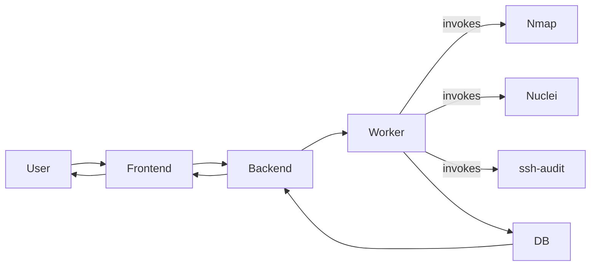

# Architecture

After reading this you'll understand:
- The major components (Frontend, Backend API, Celery Worker, Database, external tools).
- How they communicate during a scan.
- Where to look for scan-specific details.

## Components

- **Frontend (React/Vite)**: Creates scans, shows scan progress and results (`Port`s, `Vulnerability` records including LOW/INFO when configured).
- **Backend API (FastAPI)**: Exposes auth, configs, scans, reports; persists models (`Scan`, `ScanTarget`, `Port`, `ToolExecution`, `Vulnerability`).
- **Worker (Celery)**: Executes scan phases (Nmap discovery, Nmap service detection, optional ssh-audit, Nuclei). Lives in `backend/app/tasks/scan_tasks.py`.
- **Tools**: Nmap, Nuclei, ssh-audit invoked by the Worker. Service-to-`NucleiProfile` mapping lives in `backend/app/services/service_profile.py` with config in `backend/config/nuclei_profiles.yaml`.
- **Database**: Stores scan metadata, ports, tool executions, vulnerabilities, comparisons, etc.

## How They Communicate

1. Frontend calls Backend API to create/start scans.
2. Backend schedules work to Celery; Worker runs tools and writes results to DB.
3. Frontend polls APIs to render `Port`s and `Vulnerability` records (including LOW/INFO severities when `nuclei_severity` includes them).

## Diagram

See the Mermaid source at [`mermaid/system-overview.mmd`](mermaid/system-overview.mmd) for the top-level view. Simplified inline:

## Related Documentation

- **Scan flow**: [`scan-lifecycle.md`](scan-lifecycle.md) — Step-by-step phases
- **Data model**: [`data-model.md`](data-model.md) — Entity relationships
- **NucleiProfile mapping**: [`tools-nmap-nuclei.md`](tools-nmap-nuclei.md) — Service profiles and scan modes
- **Backend internals**: [`backend.md`](backend.md) — Celery tasks, tool wrappers, parsers

