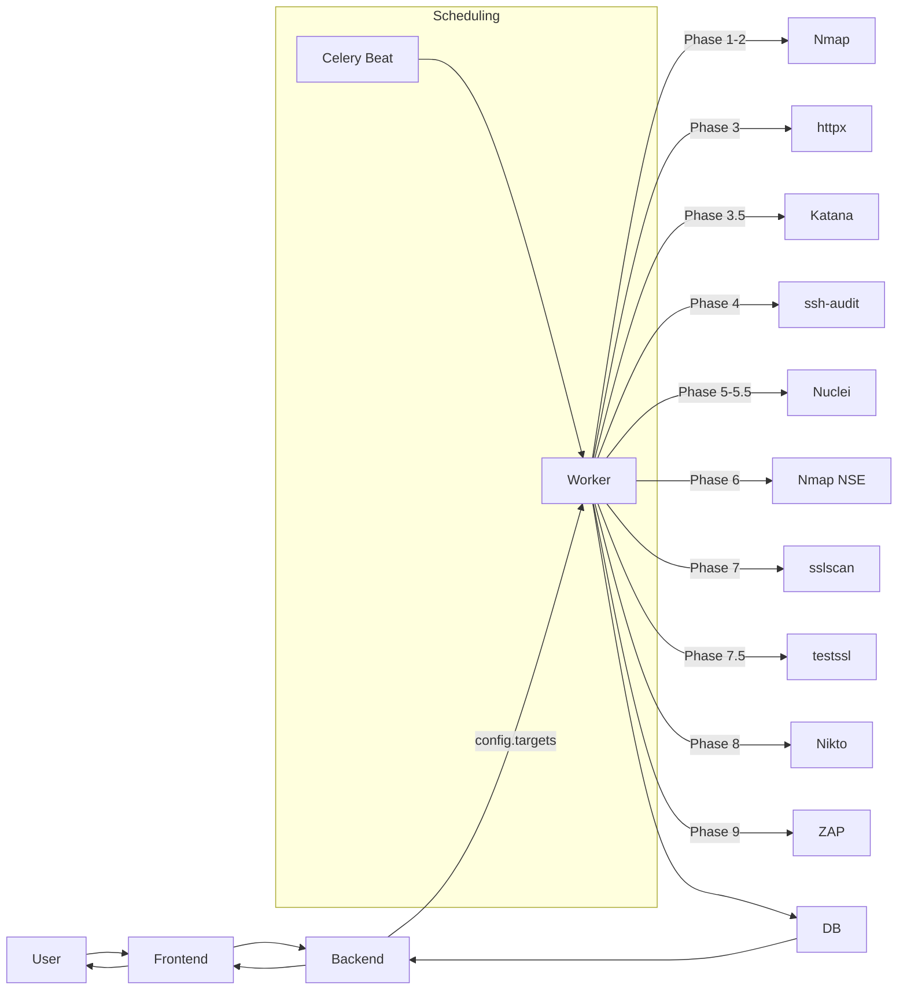

# Architecture

After reading this you'll understand:
- The major components (Frontend, Backend API, Celery Worker, Database, external tools).
- The config-centric architecture where configs define targets and settings.
- How they communicate during a scan.
- Where to look for scan-specific details.

## Config-Centric Design

PEEK uses a **config-centric** architecture:

- **ScanConfig** = Complete scan definition including targets and all settings
- **Scan** = An execution/run of a config, identified by `run_number`
- **Comparison** = Only valid between scans sharing the same `config_id`

This design enables:
- Reusable infrastructure definitions
- Meaningful run-to-run comparisons
- Run history tracking per config
- Scheduled recurring scans

## Components

- **Frontend (React/Vite)**: Manages configs with targets, starts scans, shows scan progress and results (`Port`s, `Vulnerability` records including LOW/INFO when configured). Features run history dropdown and enriched comparison views.
- **Backend API (FastAPI)**: Exposes auth, configs, scans, comparisons, reports; persists models (`ScanConfig`, `Scan`, `ScanTarget`, `Port`, `ToolExecution`, `Vulnerability`, `HttpxResult`, `DiscoveredEndpoint`, `SSHAudit`, `SslScanResult`, `TestsslResult`, `NseFinding`).
- **Worker (Celery)**: Executes the 12-phase scan pipeline. Lives in `backend/app/tasks/scan_tasks.py`.
- **Celery Beat**: Scheduler for recurring scans based on config schedule settings.
- **Tools (11 total)**: Nmap, httpx, Katana, ssh-audit, Nuclei, Nmap NSE, sslscan, testssl.sh, Nikto, ZAP, masscan (legacy). Tool wrappers live in `backend/app/tools/`, parsers in `backend/app/parsers/`.
- **Database**: Stores configs with targets, scan metadata, ports, tool executions, vulnerabilities, comparisons.

## How They Communicate

1. Frontend calls Backend API to create/edit configs (with targets) and start scans.
2. Backend creates a Scan record with auto-incremented `run_number` and schedules work to Celery.
3. Worker copies targets from config to ScanTarget rows, runs tools, and writes results to DB.
4. Frontend polls APIs to render `Port`s and `Vulnerability` records (including LOW/INFO severities when `nuclei_severity` includes them).
5. Comparison API validates scans share the same `config_id` before generating enriched diffs.

## Diagram

See the Mermaid source at [`mermaid/system-overview.mmd`](mermaid/system-overview.mmd) for the top-level view. Simplified inline:

## Key Architectural Decisions

1. **Targets on Config**: Targets are stored on `ScanConfig.targets` (JSON array), not on the scan itself. This enables config reuse and meaningful comparisons.

2. **Run Numbers**: Each scan gets an auto-incremented `run_number` per config, enabling run history tracking.

3. **Same-Config Comparisons**: The comparison engine only allows comparing scans with the same `config_id`, ensuring apples-to-apples comparisons.

4. **Enriched Comparisons**: Port and vulnerability diffs include version, product, and associated findings for context.

## Related Documentation

- **Scan flow**: [`scan-lifecycle.md`](scan-lifecycle.md) -- All 12 phases explained
- **Tool documentation**: [`tools/`](tools/) -- Individual tool guides (11 tools)
- **Data model**: [`data-model.md`](data-model.md) -- Entity relationships
- **Backend internals**: [`backend.md`](backend.md) -- Celery tasks, tool wrappers, parsers
- **Frontend**: [`frontend.md`](frontend.md) -- React components and state management
