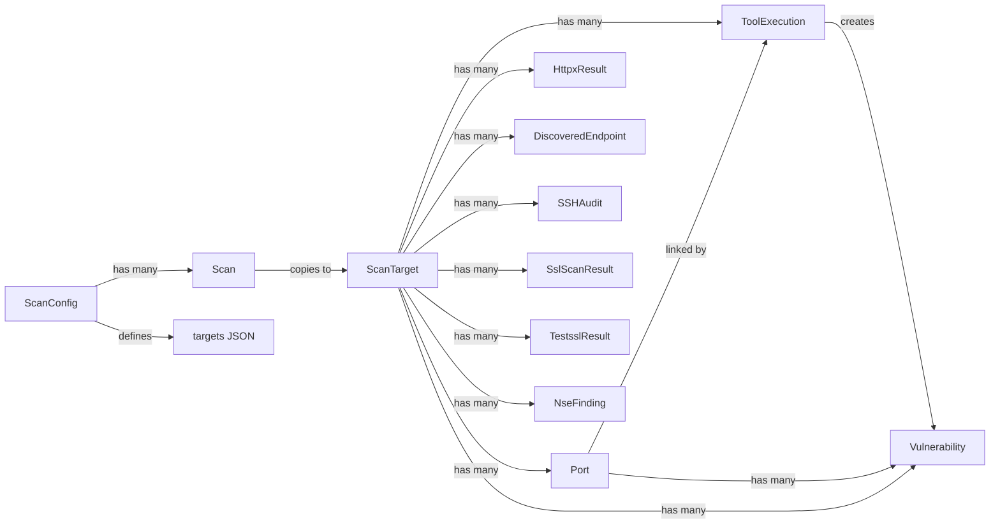

# Data Model

After reading this you'll understand:
- The core entities involved in scans and vulnerability storage.
- How `ScanConfig`, `Scan`, `ScanTarget`, `Port`, `ToolExecution`, and `Vulnerability` relate.
- The config-centric architecture where configs define **what** and **how** to scan.
- Where Nmap/Nuclei results land in the database.

## Config-Centric Architecture

PEEK uses a **config-centric** design:

- **ScanConfig** = Complete scan definition (targets + settings)
- **Scan** = A run/execution of a config (identified by `run_number`)
- **Comparisons** = Only meaningful between scans of the same config

This means:
1. Targets are stored on the config, not the scan
2. Each scan gets an auto-incremented `run_number` per config
3. Scan names are auto-generated as "Run #N — Date" if not provided
4. The comparison API restricts comparisons to scans with the same `config_id`

## Key Models

### Core Models

| Model | Description | Key Fields |
|-------|-------------|------------|
| `ScanConfig` | User-defined scan definition | `name`, `targets` (JSON array), `nmap_args`, `nuclei_severity`, `scan_mode`, scheduling fields, tool toggles |
| `Scan` | A single execution of a config | `config_id`, `run_number`, `status`, `current_phase`, `progress`, `config_snapshot` (JSON of the config at execution time), `config_hash` (SHA-256 of comparable fields), timestamps |
| `ScanTarget` | An individual IP/device in a scan | `ip_address`, `device_name`, `status`, timing; links to all result models |
| `Port` | An open port discovered on a `ScanTarget` | `port`, `protocol`, `state`, `service_name`, `product`, `version`, `extra_info`, `discovered_by` |
| `ToolExecution` | One run of an external tool | `tool_name`, `command_line`, `raw_output`, `exit_code`, `port_id` (optional), timing |
| `Vulnerability` | A finding from Nuclei/Nikto/ZAP | `template_id`, `name`, `severity`, `vuln_type`, `matched_at`, `host`, `port`, `port_id`, `discovery_source`, `tags` |

### Tool Result Models

| Model | Tool | Key Fields |
|-------|------|------------|
| `HttpxResult` | httpx | `url`, `status_code`, `title`, `webserver`, `technologies` (JSON), `tls_version`, `jarm_hash`, `screenshot_path` |
| `DiscoveredEndpoint` | Katana | `url`, `method`, `status_code`, `content_type`, `depth`, `source` |
| `SSHAudit` | ssh-audit | `banner`, `ssh_version`, `key_exchange` (JSON), `encryption` (JSON), `vulnerabilities` (JSON), `recommendations` (JSON) |
| `SslScanResult` | sslscan | Protocol flags (`sslv2_enabled`, `tlsv13_enabled`, etc.), `ciphers` (JSON), certificate fields, `heartbleed_vulnerable` |
| `TestsslResult` | testssl.sh | `raw_json`, `protocol_support` (JSON), `vulnerabilities` (JSON), `certificate_info` (JSON), `overall_grade` |
| `NseFinding` | Nmap NSE | `port`, `protocol`, `script_id`, `output`, `elements` (JSON), `severity` |

## ScanConfig Fields

| Field | Type | Description |
|-------|------|-------------|
| `targets` | JSON array | List of IPs/hostnames to scan (e.g., `["192.168.1.1", "10.0.0.5"]`) |
| `schedule` | String | Cron expression for recurring scans (e.g., `"0 2 * * 0"` = Sunday 2am) |
| `schedule_enabled` | Boolean | Whether scheduled runs are active |
| `last_scheduled_run` | DateTime | Timestamp of last scheduled execution |
| `scan_mode` | String | `"fast"` (top-ports) or `"deep"` (comprehensive) |
| `discovery_top_ports` | Integer | Number of top ports for Nmap (default: 1000) |
| `additional_ports` | String | Comma-separated ports always scanned (HTTP, databases, etc.) |

## Scan Fields

| Field | Type | Description |
|-------|------|-------------|
| `config_id` | FK | Reference to the ScanConfig used |
| `run_number` | Integer | Auto-incremented per config (1, 2, 3...) |
| `name` | String | Optional; auto-generated as "Run #N — Date" if null |
| `status` | Enum | `pending`, `queued`, `running`, `completed`, `failed`, `cancelled` |
| `current_phase` | Enum | Current tool phase (nmap, ssh_audit, nuclei, etc.) |
| `config_snapshot` | JSON | Full snapshot of the `ScanConfig` at execution time (targets, toggles, tool settings). Frozen at scan-creation; survives later config edits. |
| `config_hash` | String(64) | SHA-256 of the canonical JSON of the comparable fields in `config_snapshot`. Two scans are only comparable when their `config_hash` values match. |

## Relationships

```
ScanConfig (1) ──────────> (N) Scan
                               │
                               ├──> run_number (auto-incremented)
                               │
                               └──> (N) ScanTarget
                                         │
                                         ├──> (N) Port
                                         │         │
                                         │         └──> (N) Vulnerability (via port_id)
                                         │
                                         ├──> (N) ToolExecution
                                         │         │
                                         │         └──> (N) Vulnerability (via tool_execution_id)
                                         │
                                         ├──> (N) HttpxResult
                                         ├──> (N) DiscoveredEndpoint
                                         ├──> (N) SSHAudit
                                         ├──> (N) SslScanResult
                                         ├──> (N) TestsslResult
                                         └──> (N) NseFinding
```

- One `ScanConfig` → many `Scan`s (runs)
- Each `Scan` copies targets from config → creates `ScanTarget`s → discovers `Port`s
- Each tool run creates a `ToolExecution` linked to `ScanTarget` (and optionally `Port` via `port_id`)
- `Vulnerability` records link to `ScanTarget`, `ToolExecution`, and `Port` (via `port_id`)
- Tool-specific results (`HttpxResult`, `SSHAudit`, etc.) link to `ScanTarget`

## Diagram

See [`mermaid/data-model.mmd`](mermaid/data-model.mmd). Inline view:



## Data Flow

| Phase | Action | Model Updates |
|-------|--------|---------------|
| Scan start | Copy targets from config | Creates `ScanTarget` rows from `config.targets` |
| 1. Nmap discovery | Find open ports | Creates `Port` rows (`state=open`) |
| 2. Nmap service detection | Identify services | Updates `Port` with `service_name`, `product`, `version`, `extra_info` |
| 3. httpx | HTTP probing | Creates `HttpxResult` records |
| 3.5. Katana | Endpoint discovery | Creates `DiscoveredEndpoint` records |
| 4. ssh-audit | Analyze SSH config | Creates `SSHAudit` records |
| 5. Nuclei per-port | Scan for vulnerabilities | Creates `ToolExecution` and `Vulnerability` records |
| 5.5. Nuclei endpoints | Scan discovered endpoints | Creates `Vulnerability` records with `discovery_source='endpoint'` |
| 6. NSE scripts | Service-specific checks | Creates `NseFinding` records |
| 7. sslscan | Quick TLS analysis | Creates `SslScanResult` records |
| 7.5. testssl.sh | Deep TLS analysis | Creates `TestsslResult` records |
| 8. Nikto | Web server scanning | Creates `Vulnerability` records |
| 9. ZAP | Web app testing | Creates `Vulnerability` records |

## Comparison Constraints

The comparison engine enforces:

1. **Same `config_hash` only**: Scans must share the same `config_hash` to be compared. `config_id` is a weaker check — editing a config after a scan has run changes the hash and breaks comparability with prior runs on that same config_id. This is enforced in `POST /api/comparisons/compare` and surfaced in the UI by `GET /api/scans/{id}/comparable`, which the compare-modal dropdown consumes directly.
2. **Chronological ordering**: The API auto-swaps the `baseline` and `current` arguments if the caller passes them out of chronological order; the diff is always emitted as older → newer.
3. **Enriched output**: Comparisons include version, product, and associated vulnerabilities for changed ports.

This ensures meaningful comparisons between runs of the same infrastructure definition.

## Creation/Update Touchpoints

| Model | Created By | Updated By |
|-------|------------|------------|
| `ScanConfig` | API (configs router) | API (edit config) |
| `Scan` | API (scans router), Celery Beat (scheduled) | Worker (status/progress updates) |
| `ScanTarget` | Worker (from config.targets at scan start) | Worker (status updates) |
| `Port` | Nmap discovery parser | Nmap service detection parser |
| `ToolExecution` | Celery tasks (`scan_tasks.py`) | -- |
| `Vulnerability` | Nuclei/Nikto/ZAP parsers | -- |
| `HttpxResult` | httpx parser | -- |
| `DiscoveredEndpoint` | Katana parser | -- |
| `SSHAudit` | ssh-audit parser | -- |
| `SslScanResult` | sslscan parser | -- |
| `TestsslResult` | testssl parser | -- |
| `NseFinding` | Nmap NSE parser | -- |

## Related Documentation

- **Pipeline behavior**: [`backend.md`](backend.md) -- Celery tasks, parsers
- **Scan phases**: [`scan-lifecycle.md`](scan-lifecycle.md) -- All 12 phases explained
- **Tool documentation**: [`tools/`](tools/) -- Individual tool guides
