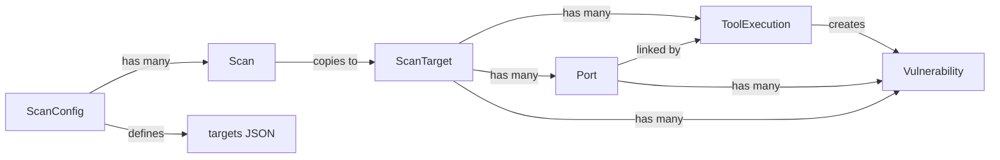

# Data Model

After reading this you'll understand:
- The core entities involved in scans and vulnerability storage.
- How `ScanConfig`, `Scan`, `ScanTarget`, `Port`, `ToolExecution`, and `Vulnerability` relate.
- The config-centric architecture where configs define **what** and **how** to scan.
- Where Nmap/Nuclei results land in the database.

## Config-Centric Architecture

PEEK uses a **config-centric** design:

- **ScanConfig** = Complete scan definition (targets + settings)
- **Scan** = A run/execution of a config (identified by `run_number`)
- **Comparisons** = Only meaningful between scans of the same config

This means:
1. Targets are stored on the config, not the scan
2. Each scan gets an auto-incremented `run_number` per config
3. Scan names are auto-generated as "Run #N — Date" if not provided
4. The comparison API restricts comparisons to scans with the same `config_id`

## Key Models

| Model | Description | Key Fields |
|-------|-------------|------------|
| `ScanConfig` | User-defined scan definition | `name`, `targets` (JSON array), `nmap_args`, `nuclei_severity`, `scan_mode`, scheduling fields |
| `Scan` | A single execution of a config | `config_id`, `run_number`, `status`, `current_phase`, `progress`, timestamps |
| `ScanTarget` | An individual IP/device in a scan | `ip_address`, `device_name`, `status`, timing; links to `Port`s and `ToolExecution`s |
| `Port` | An open port discovered on a `ScanTarget` | `port`, `protocol`, `state`, `service_name`, `product`, `version`, `extra_info`, `discovered_by` |
| `ToolExecution` | One run of an external tool | `tool_name`, `command_line`, `raw_output`, `exit_code`, `port_id` (optional), timing |
| `Vulnerability` | A finding parsed from Nuclei output | `template_id`, `name`, `severity`, `vuln_type`, `matched_at`, `host`, `port`, `port_id`, `tags`, `references` |

## ScanConfig Fields

| Field | Type | Description |
|-------|------|-------------|
| `targets` | JSON array | List of IPs/hostnames to scan (e.g., `["192.168.1.1", "10.0.0.5"]`) |
| `schedule` | String | Cron expression for recurring scans (e.g., `"0 2 * * 0"` = Sunday 2am) |
| `schedule_enabled` | Boolean | Whether scheduled runs are active |
| `last_scheduled_run` | DateTime | Timestamp of last scheduled execution |
| `scan_mode` | String | `"fast"` (top-ports) or `"deep"` (comprehensive) |
| `discovery_top_ports` | Integer | Number of top ports for Nmap (default: 1000) |
| `additional_ports` | String | Comma-separated ports always scanned (HTTP, databases, etc.) |

## Scan Fields

| Field | Type | Description |
|-------|------|-------------|
| `config_id` | FK | Reference to the ScanConfig used |
| `run_number` | Integer | Auto-incremented per config (1, 2, 3...) |
| `name` | String | Optional; auto-generated as "Run #N — Date" if null |
| `status` | Enum | `pending`, `queued`, `running`, `completed`, `failed`, `cancelled` |
| `current_phase` | Enum | Current tool phase (nmap, ssh_audit, nuclei, etc.) |

## Relationships

```
ScanConfig (1) ──────────> (N) Scan
                               │
                               ├──> run_number (auto-incremented)
                               │
                               └──> (N) ScanTarget
                                         │
                                         ├──> (N) Port
                                         │         │
                                         │         └──> (N) Vulnerability (via port_id)
                                         │
                                         └──> (N) ToolExecution
                                                   │
                                                   └──> (N) Vulnerability (via tool_execution_id)
```

- One `ScanConfig` → many `Scan`s (runs)
- Each `Scan` copies targets from config → creates `ScanTarget`s → discovers `Port`s
- Each tool run creates a `ToolExecution` linked to `ScanTarget` (and optionally `Port` via `port_id`)
- `Vulnerability` records link to `ScanTarget`, `ToolExecution`, and `Port` (via `port_id`)

## Diagram

See [`mermaid/data-model.mmd`](mermaid/data-model.mmd). Inline view:



## Data Flow

| Phase | Action | Model Updates |
|-------|--------|---------------|
| Scan start | Copy targets from config | Creates `ScanTarget` rows from `config.targets` |
| Nmap discovery | Find open ports | Creates `Port` rows (`state=open`) |
| Nmap service detection | Identify services | Updates `Port` with `service_name`, `product`, `version`, `extra_info` |
| ssh-audit | Analyze SSH config | Creates `ToolExecution`, may create findings |
| Nuclei | Scan for vulnerabilities | Creates `ToolExecution` (with `port_id`), creates `Vulnerability` records |

## Comparison Constraints

The comparison engine enforces:

1. **Same config only**: Scans must share the same `config_id` to be compared
2. **Enriched output**: Comparisons include version, product, and associated vulnerabilities for changed ports

This ensures meaningful comparisons between runs of the same infrastructure definition.

## Creation/Update Touchpoints

| Model | Created By | Updated By |
|-------|------------|------------|
| `ScanConfig` | API (configs router) | API (edit config) |
| `Scan` | API (scans router), Celery Beat (scheduled) | Worker (status/progress updates) |
| `ScanTarget` | Worker (from config.targets at scan start) | Worker (status updates) |
| `Port` | Nmap discovery parser | Nmap service detection parser |
| `ToolExecution` | Celery tasks (`scan_tasks.py`) | -- |
| `Vulnerability` | Nuclei parser (`nuclei_parser.py`) | -- |

## Related Documentation

- **Pipeline behavior**: [`backend.md`](backend.md) -- Celery tasks, parsers
- **Scan phases**: [`scan-lifecycle.md`](scan-lifecycle.md) -- End-to-end flow
- **Nmap/Nuclei details**: [`tools-nmap-nuclei.md`](tools-nmap-nuclei.md) -- Tool invocation
