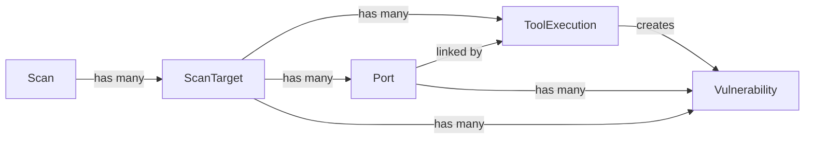

# Data Model

After reading this you'll understand:
- The core entities involved in scans and vulnerability storage.
- How `Scan`, `ScanTarget`, `Port`, `ToolExecution`, and `Vulnerability` relate.
- Where Nmap/Nuclei results land in the database.

## Key Models

| Model | Description | Key Fields |
|-------|-------------|------------|
| `Scan` | A user-initiated scan job | `status`, `current_phase`, `progress`, `total_*` counts, `config_id`, timestamps |
| `ScanTarget` | An individual IP/device in a scan | `ip_address`, `device_name`, `status`, timing; links to `Port`s and `ToolExecution`s |
| `Port` | An open port discovered on a `ScanTarget` | `port`, `protocol`, `state`, `service_name`, `product`, `version`, `extra_info`, `discovered_by` |
| `ToolExecution` | One run of an external tool | `tool_name`, `command_line`, `raw_output`, `exit_code`, `port_id` (optional), timing |
| `Vulnerability` | A finding parsed from Nuclei output | `template_id`, `name`, `severity`, `vuln_type`, `matched_at`, `host`, `port`, `port_id`, `tags`, `references` |
| `ScanConfig` | User-defined scan settings | `nuclei_severity`, `nuclei_templates`, `scan_mode` (`fast`/`deep`), timeouts, `nmap_args` |

## Relationships

```
Scan (1) ──────────> (N) ScanTarget
                          │
                          ├──> (N) Port
                          │         │
                          │         └──> (N) Vulnerability (via port_id)
                          │
                          └──> (N) ToolExecution
                                    │
                                    └──> (N) Vulnerability (via tool_execution_id)
```

- One `Scan` → many `ScanTarget`s → many `Port`s
- Each tool run creates a `ToolExecution` linked to `ScanTarget` (and optionally `Port` via `port_id`)
- `Vulnerability` records link to `ScanTarget`, `ToolExecution`, and `Port` (via `port_id`)

## Diagram

See [`mermaid/data-model.mmd`](mermaid/data-model.mmd). Inline view:



## Data Flow

| Phase | Action | Model Updates |
|-------|--------|---------------|
| Nmap discovery | Find open ports | Creates `Port` rows (`state=open`) |
| Nmap service detection | Identify services | Updates `Port` with `service_name`, `product`, `version`, `extra_info` |
| ssh-audit | Analyze SSH config | Creates `ToolExecution`, may create findings |
| Nuclei | Scan for vulnerabilities | Creates `ToolExecution` (with `port_id`), creates `Vulnerability` records |

## Creation/Update Touchpoints

| Model | Created By | Updated By |
|-------|------------|------------|
| `Scan`, `ScanTarget` | API (scans router) | Worker (status/progress updates) |
| `Port` | Nmap discovery parser | Nmap service detection parser |
| `ToolExecution` | Celery tasks (`scan_tasks.py`) | — |
| `Vulnerability` | Nuclei parser (`nuclei_parser.py`) | — |

## Related Documentation

- **Pipeline behavior**: [`backend.md`](backend.md) — Celery tasks, parsers
- **Scan phases**: [`scan-lifecycle.md`](scan-lifecycle.md) — End-to-end flow
- **Nmap/Nuclei details**: [`tools-nmap-nuclei.md`](tools-nmap-nuclei.md) — Tool invocation
