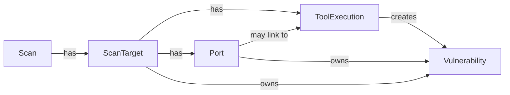

# Data Model

After reading this you’ll understand:
- The core entities involved in scans and vulnerability storage.
- How scans, targets, ports, tool executions, and vulnerabilities relate.
- Where nuclei/Nmap results land in the database.

## Key models (business meaning + important fields)
- **Scan**: A user-initiated scan job. Fields: status/current_phase, progress, counts (targets, open ports, vulnerabilities), config_id, timestamps.
- **ScanTarget**: An individual IP/device in a scan. Fields: ip_address, device_name, status, timing; links to ports and tool executions.
- **Port**: An open port discovered on a ScanTarget. Fields: port, protocol, state; service enrichment from Nmap (`service_name`, `product`, `version`, `extra_info`); discovered_by (nmap/masscan); linked to the ScanTarget and to the ToolExecution that last updated it.
- **ToolExecution**: One run of an external tool (masscan/nmap/ssh-audit/nuclei). Fields: tool_name, command_line, raw_output/raw_format, exit_code, timing; links to ScanTarget and optionally Port (for per-port tools like nuclei).
- **Vulnerability**: A finding parsed from nuclei output. Fields: template_id, name, severity (includes low/info if nuclei emits them), vuln_type, matched_at/host/port, tags, references; links to ScanTarget, ToolExecution, and optionally Port.
- **ScanConfig** (context): User-defined settings that drive tool args and severity (`nuclei_severity`, `nuclei_templates`, `scan_mode` fast/deep, timeouts, etc.).

## Relationships and flow
- One **Scan** → many **ScanTargets** → many **Ports**.
- Each tool run creates a **ToolExecution** linked to a ScanTarget (and often a Port for per-port runs).
- **Nmap discovery** creates Ports (state=open).
- **Nmap service detection** updates Ports with `service_name`/`product`/`version`/`extra_info`.
- **Nuclei** runs per scannable Port; its ToolExecution links to that Port and ScanTarget. Parsed nuclei findings create **Vulnerabilities** linked to ScanTarget, ToolExecution, and Port when available.

## Diagram
See `docs/mermaid/data-model.mmd` (source of truth). Inline view:

## Creation/update touchpoints (where these models are used)
- **Scan/ScanTarget**: created via API (scans router) before work starts.
- **Port**: created during Nmap discovery; enriched during Nmap service detection.
- **ToolExecution**: created for each tool run in Celery tasks (`scan_tasks.py`), capturing command_line, timings, raw output.
- **Vulnerability**: created in nuclei parser (`nuclei_parser.py`) after nuclei JSONL output is parsed; port linkage is passed from the nuclei run context.

For more on behavior and pipeline, see `backend.md` and `scan-lifecycle.md`.
