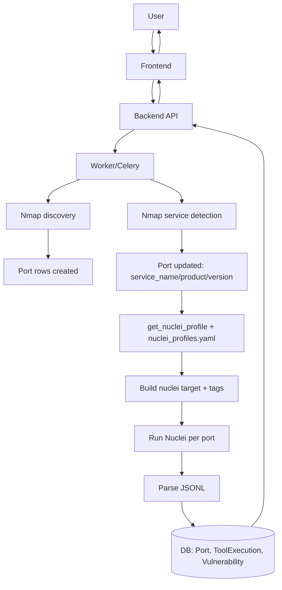

# Scan Lifecycle

After reading this you'll understand:
- How a scan progresses from user action to Nuclei results in the UI.
- Where Nmap, `NucleiProfile` mapping, and Nuclei fit.
- How severities (including LOW/INFO) are handled.

## End-to-End Flow (Summary)

1. User creates/starts a scan via the Frontend/API. Backend stores `Scan` and `ScanTarget` records.
2. Worker (Celery) runs discovery (Nmap top ports) → creates `Port` rows (open ports).
3. Worker runs Nmap service detection on open ports → updates `Port` with `service_name`, `product`, `version`, `extra_info`.
4. For each open port, Worker calls `get_nuclei_profile()` (config in `backend/config/nuclei_profiles.yaml`) to decide:
   - Target format (`url` vs `host:port`), protocol for URLs
   - Tags (empty = comprehensive) and timeout multiplier, optional `rate_limit` per profile
   - Whether to scan unknown services (configurable fallback)
   - Apply scan mode (`scan_mode` from `ScanConfig`: `fast` or `deep`) for HTTP tags
5. **Tag validation**: If a `NucleiProfile` has tags, Worker validates that Nuclei has templates for those tags (`nuclei -tl -tags ...`). `Port`s are skipped (with a warning) if no templates match.
6. **Exclusions**: Global template exclusions from `nuclei_profiles.yaml` are passed to Nuclei as `-exclude-templates ...`.
7. Worker builds Nuclei targets with `build_nuclei_target()` and runs Nuclei **per port** with:
   - `-target <target>`
   - `-severity <config.nuclei_severity>` (defaults to `critical,high,medium,low,info`)
   - `-jsonl-export <file>`
   - `-silent -no-color -no-interactsh`
   - `-rate-limit` (profile-specific or default 150)
   - Optional `-tags <comma>` when profile tags are non-empty (HTTP `fast` mode uses targeted HTTP tags)
   - Optional `-templates <path>` when `nuclei_templates` is set in `ScanConfig`
   - Optional `-exclude-templates <pattern>` from exclusions
8. Nuclei output (JSONL) is parsed; `Vulnerability` records are stored with severity, `port_id` linkage, and template info.
9. Frontend pages fetch and display `Port`s and `Vulnerability` records. LOW/INFO rows appear when the severity filter includes them.

## Diagram

See [`mermaid/scan-lifecycle.mmd`](mermaid/scan-lifecycle.mmd). Inline view:

## Key Files

| Purpose | File |
|---------|------|
| Orchestration | `backend/app/tasks/scan_tasks.py` (`run_scan`, `run_nuclei_phase`) |
| Nmap runner/parser | `backend/app/tools/nmap.py`, `backend/app/parsers/nmap_parser.py` |
| NucleiProfile mapping | `backend/app/services/service_profile.py`, `backend/config/nuclei_profiles.yaml` |
| Nuclei runner/parser | `backend/app/tools/nuclei.py`, `backend/app/parsers/nuclei_parser.py` |
| Models | `Scan`, `ScanTarget`, `Port`, `ToolExecution`, `Vulnerability` |

## Severity Handling

- Default severity filter: `critical,high,medium,low,info`. Adjust `nuclei_severity` in `ScanConfig` to filter.
- `Vulnerability` records are stored with their reported severity; no post-filtering beyond what Nuclei emits.
- LOW/INFO findings appear in the UI when `nuclei_severity` includes them.

## Related Documentation

- **Data model**: [`data-model.md`](data-model.md) — Entity relationships and `port_id` linkage
- **Nmap & Nuclei details**: [`tools-nmap-nuclei.md`](tools-nmap-nuclei.md) — Tool invocation, scan modes
- **Usage guide**: [`usage-guide.md`](usage-guide.md) — Running fast/deep scans
- **Troubleshooting**: [`troubleshooting.md`](troubleshooting.md) — Common issues
