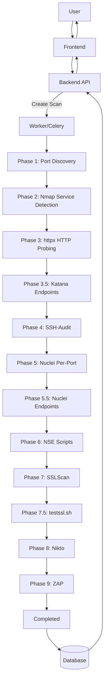

# Scan Lifecycle

After reading this you'll understand:
- How a scan progresses from user action through all 12 phases to completion.
- The config-centric architecture where configs define targets and scans are executions.
- What each phase does, its inputs, outputs, and dependencies.
- How severities (including LOW/INFO) are handled.

## Config-Centric Model

PEEK uses a **config-centric** architecture:

1. **ScanConfig** contains targets (IPs/hostnames) and all scan settings
2. **Scan** is an execution/run of a config, identified by `run_number`
3. Targets are copied from the config to `ScanTarget` rows at scan start
4. Comparisons are only meaningful between runs of the same config

## The 12-Phase Pipeline

PEEK executes scans in a sequential pipeline with 12 phases. Each phase is optional based on config toggles.

| Phase | Name | Progress | Config Toggle | Description |
|-------|------|----------|---------------|-------------|
| 1 | Port Discovery | 0% → 10% | Always on | Nmap discovers open ports |
| 2 | Nmap Service Detection | 10% → 75% | Always on | Identifies services on open ports |
| 3 | httpx HTTP Probing | 75% → 78% | `enable_httpx` | HTTP probing with tech detection |
| 3.5 | Katana Endpoint Discovery | 78% → 80% | `enable_katana` | Crawls web apps to find endpoints |
| 4 | SSH-Audit | 80% → 85% | `enable_ssh_audit` | SSH security analysis |
| 5 | Nuclei Per-Port | 85% → 88% | `enable_nuclei` | Vulnerability scanning per port |
| 5.5 | Nuclei Endpoints | 88% → 91% | `enable_nuclei_endpoints` | Scans discovered endpoints |
| 6 | NSE Scripts | 91% → 93% | `enable_nse` | Nmap scripting engine checks |
| 7 | SSLScan | 93% → 95% | `enable_sslscan` | Quick TLS/SSL analysis |
| 7.5 | testssl.sh | 95% → 97% | `enable_testssl` | Deep TLS analysis |
| 8 | Nikto | 97% → 98% | `enable_nikto` | Web server vulnerability scanning |
| 9 | ZAP | 98% → 100% | `enable_zap` | OWASP ZAP baseline scan |

## Phase Details

### Phase 1: Port Discovery (Nmap)

**What it does**: Discovers open ports on all targets using Nmap's top-ports scan.

**Inputs**: `config.targets` (IPs/hostnames), `discovery_top_ports` setting

**Outputs**: Creates `Port` rows with `state=open`

**Command pattern**:
```bash
nmap --top-ports <N> -Pn -sT -T4 --open -oX <output.xml> <target>
```

**Dependencies**: None (first phase)

---

### Phase 2: Nmap Service Detection

**What it does**: Runs service version detection on discovered open ports.

**Inputs**: Open ports from Phase 1

**Outputs**: Updates `Port` with `service_name`, `product`, `version`, `extra_info`

**Command pattern**:
```bash
nmap -sT -sV -sC -T2 -Pn -p <ports> -oX <output.xml> <target>
```

**Dependencies**: Phase 1 (needs open ports)

---

### Phase 3: httpx HTTP Probing

**What it does**: Probes HTTP/HTTPS ports for web server information, technology detection, and optional screenshots.

**Inputs**: HTTP candidate ports (80, 443, 8080, 8443, etc.)

**Outputs**: Creates `HttpxResult` records with status codes, titles, technologies, screenshots

**Config options**: `httpx_timeout`, `httpx_tech_detect`, `httpx_screenshots`, `httpx_vhost_discovery`

**Dependencies**: Phase 2 (needs service detection to identify HTTP ports)

---

### Phase 3.5: Katana Endpoint Discovery

**What it does**: Crawls web applications to discover endpoints, forms, and API paths.

**Inputs**: Live HTTP URLs from httpx phase

**Outputs**: Creates `DiscoveredEndpoint` records with URLs, methods, parameters

**Config options**: `katana_max_depth` (default: 3)

**Dependencies**: Phase 3 (needs live HTTP URLs from httpx)

---

### Phase 4: SSH-Audit

**What it does**: Analyzes SSH server configurations for security issues.

**Inputs**: Ports with `service_name` containing "ssh" (typically port 22)

**Outputs**: Creates `SSHAudit` records with key exchange, cipher, and MAC analysis

**Dependencies**: Phase 2 (needs service detection to identify SSH ports)

---

### Phase 5: Nuclei Per-Port

**What it does**: Runs Nuclei vulnerability scanner against each discovered port.

**Inputs**: All scannable ports with service profiles

**Outputs**: Creates `Vulnerability` records linked to `Port` via `port_id`

**Config options**: `nuclei_severity`, `nuclei_timeout`, `nuclei_templates`, `scan_mode`

**Key behavior**:
- Uses `NucleiProfile` mapping from `nuclei_profiles.yaml` to determine target format and tags
- `scan_mode=fast` uses targeted HTTP tags; `scan_mode=deep` is comprehensive
- Tag validation skips ports with no matching templates

**Dependencies**: Phase 2 (needs service detection for profile mapping)

---

### Phase 5.5: Nuclei Endpoint Mode

**What it does**: Runs Nuclei against discovered endpoints from Katana.

**Inputs**: `DiscoveredEndpoint` records from Phase 3.5

**Outputs**: Creates `Vulnerability` records with `discovery_source='endpoint'`

**Config options**: `nuclei_endpoint_severity`, `nuclei_endpoint_timeout`

**Dependencies**: Phase 3.5 (needs discovered endpoints from Katana)

---

### Phase 6: NSE Scripts

**What it does**: Runs Nmap Scripting Engine scripts for additional service analysis.

**Inputs**: Ports with known services

**Outputs**: Creates `NseFinding` records with script results and severity

**Config options**: `enable_nse`

**Dependencies**: Phase 2 (needs service detection)

---

### Phase 7: SSLScan

**What it does**: Quick SSL/TLS analysis of encrypted services.

**Inputs**: TLS candidate ports (443, 8443, ports with SSL services)

**Outputs**: Creates `SslScanResult` records with certificate and cipher information

**Dependencies**: Phase 2 (needs service detection to identify TLS ports)

---

### Phase 7.5: testssl.sh

**What it does**: Deep TLS analysis with comprehensive vulnerability checks.

**Inputs**: TLS candidate ports

**Outputs**: Creates `TestsslResult` records with detailed TLS analysis

**Config options**: `testssl_timeout`

**Dependencies**: Phase 2 (needs service detection)

---

### Phase 8: Nikto

**What it does**: Web server vulnerability scanning for misconfigurations and known vulnerabilities.

**Inputs**: HTTP/HTTPS ports

**Outputs**: Creates `Vulnerability` records from Nikto findings

**Config options**: `nikto_timeout`

**Dependencies**: Phase 2 (needs HTTP ports identified)

---

### Phase 9: ZAP

**What it does**: OWASP ZAP baseline scan for web application vulnerabilities.

**Inputs**: HTTP/HTTPS URLs

**Outputs**: Creates `Vulnerability` records from ZAP findings

**Config options**: `zap_scan_type`, `zap_timeout`

**Dependencies**: Phase 2 (needs HTTP ports identified)

---

## Diagram

See [`mermaid/scan-lifecycle.mmd`](mermaid/scan-lifecycle.mmd). Inline view:



## Run Number Assignment

When a new scan is created:

1. Query max `run_number` for the given `config_id`
2. Assign `run_number = max + 1` (or 1 if first run)
3. Auto-generate name as "Run #N -- YYYY-MM-DD" if not provided

This enables:
- Run history dropdown showing all runs of a config
- Meaningful comparisons between runs
- Easy identification of scan executions

## Key Files

| Purpose | File |
|---------|------|
| Orchestration | `backend/app/tasks/scan_tasks.py` |
| Nmap | `backend/app/tools/nmap.py`, `backend/app/parsers/nmap_parser.py` |
| httpx | `backend/app/tools/httpx.py`, `backend/app/parsers/httpx_parser.py` |
| Katana | `backend/app/tools/katana.py`, `backend/app/parsers/katana_parser.py` |
| SSH-Audit | `backend/app/tools/ssh_audit.py`, `backend/app/parsers/ssh_audit_parser.py` |
| Nuclei | `backend/app/tools/nuclei.py`, `backend/app/parsers/nuclei_parser.py` |
| NSE | `backend/app/tools/nmap_nse.py` |
| SSLScan | `backend/app/tools/sslscan.py` |
| testssl | `backend/app/tools/testssl.py`, `backend/app/parsers/testssl_parser.py` |
| Nikto | `backend/app/tools/nikto.py`, `backend/app/parsers/nikto_parser.py` |
| ZAP | `backend/app/tools/zap.py`, `backend/app/parsers/zap_parser.py` |
| NucleiProfile mapping | `backend/app/services/service_profile.py`, `backend/config/nuclei_profiles.yaml` |

## Severity Handling

- Default severity filter: `critical,high,medium,low,info`. Adjust `nuclei_severity` in `ScanConfig` to filter.
- `Vulnerability` records are stored with their reported severity; no post-filtering beyond what Nuclei emits.
- LOW/INFO findings appear in the UI when `nuclei_severity` includes them.

## Scheduled Scans

For recurring scans, Celery Beat checks `ScanConfig` records where:
- `schedule_enabled = True`
- `schedule` contains a valid cron expression
- Current time matches the cron schedule

When triggered:
1. Creates a new `Scan` with next `run_number`
2. Copies `config.targets` to `ScanTarget` rows
3. Executes the normal scan pipeline
4. Updates `last_scheduled_run` on the config

## Related Documentation

- **Data model**: [`data-model.md`](data-model.md) -- Entity relationships and `port_id` linkage
- **Tool documentation**: [`tools/`](tools/) -- Individual tool deep dives
- **Usage guide**: [`usage-guide.md`](usage-guide.md) -- Running fast/deep scans
- **Troubleshooting**: [`troubleshooting.md`](troubleshooting.md) -- Common issues
